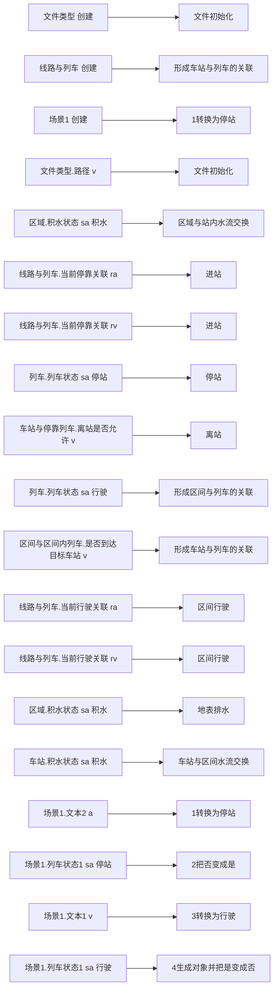

# GROMA 模型全局语义导航地图：应急决策推演-关联副本-1029 (v647)

> 本文件由方圆模型编译器自动生成，供大模型与开发者先读这一份建立全局上下文，再按需进入五层源码。

- **源模型 ID**：`3cW2TNyvVxiJxV07ZlR` | **模块编码**：`emergency-deduction-844676b1` | **根包空间**：`com.groma.models.emergencydeduction844676b1`
- **源文件摘要**：`730d416d5bb4a8eaafaeda5544e5a27cf9d281b81406392d0038d63e1ac57959:ac4c7c0de19e5cc7f3fd43a4f3b8646e40516ae4bdf618223b9fb47f287f090e`
- **默认步长**：`1000 ms`
- **规模**：对象类型 33，枚举 10，过程定义 61，事件接线 16，默认启动 3，命名实例 26

## 1. 权威运行场景清单

| 场景中文原名 | 场景编码 | 控制器路由 | 沙盒上下文类 |
|---|---|---|---|
| 场景2 | `scene2` | `/api/v1/models/emergency-deduction-844676b1/scenes/scene2` | `Scene2WorldContext` |
| 场景1 | `scene1` | `/api/v1/models/emergency-deduction-844676b1/scenes/scene1` | `Scene1WorldContext` |

## 2. 领域对象与五层符号对照总表

| 中文原名 | 类型编码 | Entity 类 | 只读契约 | VO 类 | Service | 成员数 |
|---|---|---|---|---|---|---|
| 乘客群（TYPE） | `PassengerGroup` | `PassengerGroupEntity` | `PassengerGroupReadOnly` | `PassengerGroupVO` | `IPassengerGroupService` | 7 |
| 地理路线（TYPE） | `GeoRoute` | `GeoRouteEntity` | `GeoRouteReadOnly` | `GeoRouteVO` | — | 1 |
| 文件类型（TYPE） | `FileType` | `FileTypeEntity` | `FileTypeReadOnly` | `FileTypeVO` | `IFileTypeService` | 7 |
| 地理区域（TYPE） | `GeoRegion` | `GeoRegionEntity` | `GeoRegionReadOnly` | `GeoRegionVO` | — | 1 |
| 地铁区间（TYPE） | `MetroSection` | `MetroSectionEntity` | `MetroSectionReadOnly` | `MetroSectionVO` | `IMetroSectionService` | 11 |
| 区间与区间内列车（TYPE） | `SectionWithTrain` | `SectionWithTrainEntity` | `SectionWithTrainReadOnly` | `SectionWithTrainVO` | — | 6 |
| 处置方案（TYPE） | `DisposalPlan` | `DisposalPlanEntity` | `DisposalPlanReadOnly` | `DisposalPlanVO` | — | 6 |
| 区域与区域内车站（TYPE） | `AreaWithStation` | `AreaWithStationEntity` | `AreaWithStationReadOnly` | `AreaWithStationVO` | — | 4 |
| 文件服务（TYPE） | `FileService` | `FileServiceEntity` | `FileServiceReadOnly` | `FileServiceVO` | `IFileServiceService` | 0 |
| 降雨（TYPE） | `Rainfall` | `RainfallEntity` | `RainfallReadOnly` | `RainfallVO` | `IRainfallService` | 0 |
| 线路与区间（TYPE） | `LineWithSection` | `LineWithSectionEntity` | `LineWithSectionReadOnly` | `LineWithSectionVO` | — | 4 |
| 线路与列车（TYPE） | `LineWithTrain` | `LineWithTrainEntity` | `LineWithTrainReadOnly` | `LineWithTrainVO` | `ILineWithTrainService` | 7 |
| 车站与站内乘客群（TYPE） | `StationWithPassengerGroup` | `StationWithPassengerGroupEntity` | `StationWithPassengerGroupReadOnly` | `StationWithPassengerGroupVO` | — | 6 |
| 车站与停靠列车（TYPE） | `StationWithParkedTrain` | `StationWithParkedTrainEntity` | `StationWithParkedTrainReadOnly` | `StationWithParkedTrainVO` | — | 6 |
| 地铁线路（TYPE） | `MetroLine` | `MetroLineEntity` | `MetroLineReadOnly` | `MetroLineVO` | — | 3 |
| 降雨与受影响区域（TYPE） | `RainfallAffectedArea` | `RainfallAffectedAreaEntity` | `RainfallAffectedAreaReadOnly` | `RainfallAffectedAreaVO` | — | 7 |
| 方案执行器（TYPE） | `PlanExecutor` | `PlanExecutorEntity` | `PlanExecutorReadOnly` | `PlanExecutorVO` | `IPlanExecutorService` | 4 |
| 线路与车站（TYPE） | `LineWithStation` | `LineWithStationEntity` | `LineWithStationReadOnly` | `LineWithStationVO` | — | 5 |
| 地理点位（TYPE） | `GeoPoint` | `GeoPointEntity` | `GeoPointReadOnly` | `GeoPointVO` | — | 3 |
| 区域（TYPE） | `Area` | `AreaEntity` | `AreaReadOnly` | `AreaVO` | `IAreaService` | 10 |
| 文件信息（TYPE） | `FileInfo` | `FileInfoEntity` | `FileInfoReadOnly` | `FileInfoVO` | — | 6 |
| 列车与车内乘客群（TYPE） | `TrainWithPassengerGroup` | `TrainWithPassengerGroupEntity` | `TrainWithPassengerGroupReadOnly` | `TrainWithPassengerGroupVO` | — | 3 |
| 方案生成器（TYPE） | `PlanGenerator` | `PlanGeneratorEntity` | `PlanGeneratorReadOnly` | `PlanGeneratorVO` | `IPlanGeneratorService` | 6 |
| 车站（TYPE） | `Station` | `StationEntity` | `StationReadOnly` | `StationVO` | `IStationService` | 18 |
| 列车（TYPE） | `Train` | `TrainEntity` | `TrainReadOnly` | `TrainVO` | `ITrainService` | 8 |
| 区间与端点车站（TYPE） | `SectionWithEndStation` | `SectionWithEndStationEntity` | `SectionWithEndStationReadOnly` | `SectionWithEndStationVO` | — | 7 |
| 场景2（SCENE） | `Scene2` | `Scene2Entity` | `Scene2ReadOnly` | `Scene2VO` | — | 4 |
| 场景1（SCENE） | `Scene1` | `Scene1Entity` | `Scene1ReadOnly` | `Scene1VO` | `IScene1Service` | 3 |
| 列车通行（ASSOCIATION） | `TrainPassing` | `TrainPassingEntity` | `TrainPassingReadOnly` | `TrainPassingVO` | — | 2 |
| 地下进水（ASSOCIATION） | `UndergroundInflow` | `UndergroundInflowEntity` | `UndergroundInflowReadOnly` | `UndergroundInflowVO` | — | 2 |
| 降雨汇水（ASSOCIATION） | `RainfallCatchment` | `RainfallCatchmentEntity` | `RainfallCatchmentReadOnly` | `RainfallCatchmentVO` | — | 2 |
| 挡水防护（ASSOCIATION） | `FloodProtection` | `FloodProtectionEntity` | `FloodProtectionReadOnly` | `FloodProtectionVO` | — | 2 |
| 停运控制（ASSOCIATION） | `SuspensionControl` | `SuspensionControlEntity` | `SuspensionControlReadOnly` | `SuspensionControlVO` | — | 2 |

### 2.1 成员对照（中文原名 → 英文成员 → 类型 / 单位 / 初始值）

**乘客群**

| 中文原名 | 英文成员 | 访问方法 | 种类 | 单位 | 默认值 |
|---|---|---|---|---|---|
| 名称 | `name` | `getName()` / `setName(v, ctx)` | BASE |  |  |
| 总人数 | `totalPeopleCount` | `getTotalPeopleCount()` / `setTotalPeopleCount(v, ctx)` | BASE |  |  |
| 乘客状态 | `passengerState` | `getPassengerState()` / `setPassengerState(v, ctx)` | ENUM |  |  |
| 首次受困时刻 | `firstTrappedTime` | `getFirstTrappedTime()` / `setFirstTrappedTime(v, ctx)` | BASE |  |  |
| 全部安全时刻 | `allSafeTime` | `getAllSafeTime()` / `setAllSafeTime(v, ctx)` | BASE |  |  |
| 已安全人数 | `safePeopleCount` | `getSafePeopleCount()` / `setSafePeopleCount(v, ctx)` | BASE |  |  |
| 是否经历危险水深 | `experiencedDangerDepth` | `isExperiencedDangerDepth()` / `setExperiencedDangerDepth(v, ctx)` | BASE |  | false |

**地理路线**

| 中文原名 | 英文成员 | 访问方法 | 种类 | 单位 | 默认值 |
|---|---|---|---|---|---|
| 坐标组 | `coordinateGroup` | `getCoordinateGroup()` / `setCoordinateGroup(v, ctx)` | LIST |  |  |

**文件类型**

| 中文原名 | 英文成员 | 访问方法 | 种类 | 单位 | 默认值 |
|---|---|---|---|---|---|
| 路径 | `path` | `getPath()` / `setPath(v, ctx)` | BASE |  |  |
| 名称 | `name` | `getName()` / `setName(v, ctx)` | BASE |  |  |
| 类型 | `type` | `getType()` / `setType(v, ctx)` | BASE |  |  |
| 大小 | `size` | `getSize()` / `setSize(v, ctx)` | BASE |  |  |
| 创建时间 | `createTime` | `getCreateTime()` / `setCreateTime(v, ctx)` | BASE |  |  |
| 修改时间 | `modifyTime` | `getModifyTime()` / `setModifyTime(v, ctx)` | BASE |  |  |
| 哈希值 | `hashValue` | `getHashValue()` / `setHashValue(v, ctx)` | BASE |  |  |

**地理区域**

| 中文原名 | 英文成员 | 访问方法 | 种类 | 单位 | 默认值 |
|---|---|---|---|---|---|
| 坐标组 | `coordinateGroup` | `getCoordinateGroup()` / `setCoordinateGroup(v, ctx)` | LIST |  |  |

**地铁区间**

| 中文原名 | 英文成员 | 访问方法 | 种类 | 单位 | 默认值 |
|---|---|---|---|---|---|
| 长度 | `length` | `getLength()` / `setLength(v, ctx)` | BASE | m |  |
| 等效储水宽度 | `equivalentStorageWidth` | `getEquivalentStorageWidth()` / `setEquivalentStorageWidth(v, ctx)` | BASE | m | 3 |
| 危险水深 | `dangerDepth` | `getDangerDepth()` / `setDangerDepth(v, ctx)` | BASE | m | 0.1 |
| 迫停水深 | `forcedStopDepth` | `getForcedStopDepth()` / `setForcedStopDepth(v, ctx)` | BASE | m | 0.15 |
| 积水量 | `waterVolume` | `getWaterVolume()` / `setWaterVolume(v, ctx)` | BASE | m³ |  |
| 代表性水深 | `representativeDepth` | `getRepresentativeDepth()` / `setRepresentativeDepth(v, ctx)` | BASE | m |  |
| 是否放行 | `releaseAllowed` | `isReleaseAllowed()` / `setReleaseAllowed(v, ctx)` | BASE |  | true |
| 名称 | `name` | `getName()` / `setName(v, ctx)` | BASE |  |  |
| 位置 | `position` | `getPosition()` / `setPosition(v, ctx)` | REF |  |  |
| 代表底高程 | `representativeFloorElevation` | `getRepresentativeFloorElevation()` / `setRepresentativeFloorElevation(v, ctx)` | BASE | m |  |
| 积水状态 | `waterloggingState` | `getWaterloggingState()` / `setWaterloggingState(v, ctx)` | ENUM |  |  |

**区间与区间内列车**

| 中文原名 | 英文成员 | 访问方法 | 种类 | 单位 | 默认值 |
|---|---|---|---|---|---|
| 列车 | `train` | `getTrain()` / `setTrain(v, ctx)` | REF |  |  |
| 区间 | `section` | `getSection()` / `setSection(v, ctx)` | REF |  |  |
| 已行驶距离 | `travelledDistance` | `getTravelledDistance()` / `setTravelledDistance(v, ctx)` | BASE |  | 0 |
| 目标车站 | `targetStation` | `getTargetStation()` / `setTargetStation(v, ctx)` | REF |  |  |
| 出发车站 | `departureStation` | `getDepartureStation()` / `setDepartureStation(v, ctx)` | REF |  |  |
| 是否到达目标车站 | `arrivedTargetStation` | `isArrivedTargetStation()` / `setArrivedTargetStation(v, ctx)` | BASE |  | false |

**处置方案**

| 中文原名 | 英文成员 | 访问方法 | 种类 | 单位 | 默认值 |
|---|---|---|---|---|---|
| 方案编号 | `planCode` | `getPlanCode()` / `setPlanCode(v, ctx)` | BASE |  |  |
| 方案名称 | `planName` | `getPlanName()` / `setPlanName(v, ctx)` | BASE |  |  |
| 关联列车 | `associatedTrain` | `getAssociatedTrain()` / `setAssociatedTrain(v, ctx)` | REF |  |  |
| 列车通过所需时间 | `trainPassTime` | `getTrainPassTime()` / `setTrainPassTime(v, ctx)` | BASE |  |  |
| 停运下达时刻 | `suspensionIssueTime` | `getSuspensionIssueTime()` / `setSuspensionIssueTime(v, ctx)` | BASE |  |  |
| 停止放行时刻 | `releaseStopTime` | `getReleaseStopTime()` / `setReleaseStopTime(v, ctx)` | BASE |  |  |

**区域与区域内车站**

| 中文原名 | 英文成员 | 访问方法 | 种类 | 单位 | 默认值 |
|---|---|---|---|---|---|
| 区域 | `area` | `getArea()` / `setArea(v, ctx)` | REF |  |  |
| 车站 | `station` | `getStation()` / `setStation(v, ctx)` | REF |  |  |
| 当前过水流量 | `currentFlowRate` | `getCurrentFlowRate()` / `setCurrentFlowRate(v, ctx)` | BASE | m³/min |  |
| 本步过水量 | `stepFlowVolume` | `getStepFlowVolume()` / `setStepFlowVolume(v, ctx)` | BASE | 0 |  |

**线路与区间**

| 中文原名 | 英文成员 | 访问方法 | 种类 | 单位 | 默认值 |
|---|---|---|---|---|---|
| 地铁线路 | `metroLine` | `getMetroLine()` / `setMetroLine(v, ctx)` | REF |  |  |
| 地铁区间 | `metroSection` | `getMetroSection()` / `setMetroSection(v, ctx)` | REF |  |  |
| 区间起点里程 | `sectionStartMileage` | `getSectionStartMileage()` / `setSectionStartMileage(v, ctx)` | BASE |  |  |
| 区间终点里程 | `sectionEndMileage` | `getSectionEndMileage()` / `setSectionEndMileage(v, ctx)` | BASE |  |  |

**线路与列车**

| 中文原名 | 英文成员 | 访问方法 | 种类 | 单位 | 默认值 |
|---|---|---|---|---|---|
| 线路 | `line` | `getLine()` / `setLine(v, ctx)` | REF |  |  |
| 列车 | `train` | `getTrain()` / `setTrain(v, ctx)` | REF |  |  |
| 列车当前在线路上的里程 | `trainMileageOnLine` | `getTrainMileageOnLine()` / `setTrainMileageOnLine(v, ctx)` | BASE | m |  |
| 沿里程增大方向 | `alongIncreasingMileage` | `isAlongIncreasingMileage()` / `setAlongIncreasingMileage(v, ctx)` | BASE |  | true |
| 当前停靠关联 | `currentParkedRelation` | `getCurrentParkedRelation()` / `setCurrentParkedRelation(v, ctx)` | REF |  |  |
| 当前行驶关联 | `currentRunningRelation` | `getCurrentRunningRelation()` / `setCurrentRunningRelation(v, ctx)` | REF |  |  |
| 演示往返 | `demoRoundTrip` | `isDemoRoundTrip()` / `setDemoRoundTrip(v, ctx)` | BASE |  | false |

**车站与站内乘客群**

| 中文原名 | 英文成员 | 访问方法 | 种类 | 单位 | 默认值 |
|---|---|---|---|---|---|
| 乘客群 | `passengerGroup` | `getPassengerGroup()` / `setPassengerGroup(v, ctx)` | REF |  |  |
| 车站 | `station` | `getStation()` / `setStation(v, ctx)` | REF |  |  |
| 当前站内人数 | `currentStationPeopleCount` | `getCurrentStationPeopleCount()` / `setCurrentStationPeopleCount(v, ctx)` | BASE |  |  |
| 已疏散人数 | `evacuatedPeopleCount` | `getEvacuatedPeopleCount()` / `setEvacuatedPeopleCount(v, ctx)` | BASE |  |  |
| 疏散是否启动 | `evacuationStarted` | `isEvacuationStarted()` / `setEvacuationStarted(v, ctx)` | BASE |  |  |
| 疏散状态 | `evacuationState` | `getEvacuationState()` / `setEvacuationState(v, ctx)` | ENUM |  |  |

**车站与停靠列车**

| 中文原名 | 英文成员 | 访问方法 | 种类 | 单位 | 默认值 |
|---|---|---|---|---|---|
| 列车 | `train` | `getTrain()` / `setTrain(v, ctx)` | REF |  |  |
| 车站 | `station` | `getStation()` / `setStation(v, ctx)` | REF |  |  |
| 实际离站时刻 | `actualDepartureTime` | `getActualDepartureTime()` / `setActualDepartureTime(v, ctx)` | BASE |  |  |
| 实际到站时刻 | `actualArrivalTime` | `getActualArrivalTime()` / `setActualArrivalTime(v, ctx)` | BASE |  |  |
| 规定停站时长 | `prescribedStopDuration` | `getPrescribedStopDuration()` / `setPrescribedStopDuration(v, ctx)` | BASE | s | 30 |
| 离站是否允许 | `departureAllowed` | `isDepartureAllowed()` / `setDepartureAllowed(v, ctx)` | BASE |  | false |

**地铁线路**

| 中文原名 | 英文成员 | 访问方法 | 种类 | 单位 | 默认值 |
|---|---|---|---|---|---|
| 线路名称 | `lineName` | `getLineName()` / `setLineName(v, ctx)` | BASE |  |  |
| 起点里程 | `startMileage` | `getStartMileage()` / `setStartMileage(v, ctx)` | BASE | m | 0 |
| 终点里程 | `endMileage` | `getEndMileage()` / `setEndMileage(v, ctx)` | BASE | m | 10000 |

**降雨与受影响区域**

| 中文原名 | 英文成员 | 访问方法 | 种类 | 单位 | 默认值 |
|---|---|---|---|---|---|
| 降雨 | `rainfall` | `getRainfall()` / `setRainfall(v, ctx)` | REF |  |  |
| 区域 | `area` | `getArea()` / `setArea(v, ctx)` | REF |  |  |
| 当前汇水流量 | `currentCatchmentFlow` | `getCurrentCatchmentFlow()` / `setCurrentCatchmentFlow(v, ctx)` | BASE | m³/s |  |
| 本步进汇水量 | `stepCatchmentVolume` | `getStepCatchmentVolume()` / `setStepCatchmentVolume(v, ctx)` | BASE | m³ |  |
| 当前雨强 | `currentRainIntensity` | `getCurrentRainIntensity()` / `setCurrentRainIntensity(v, ctx)` | BASE | mm/min |  |
| 累计雨量 | `cumulativeRainfall` | `getCumulativeRainfall()` / `setCumulativeRainfall(v, ctx)` | BASE | mm |  |
| 雨量序列 | `rainfallSeries` | `getRainfallSeries()` / `setRainfallSeries(v, ctx)` | MAP |  |  |

**方案执行器**

| 中文原名 | 英文成员 | 访问方法 | 种类 | 单位 | 默认值 |
|---|---|---|---|---|---|
| 在行方案 | `activePlan` | `getActivePlan()` / `setActivePlan(v, ctx)` | REF |  |  |
| 当前方案阶段 | `currentPlanStage` | `getCurrentPlanStage()` / `setCurrentPlanStage(v, ctx)` | ENUM |  | 待下达 |
| 实际下达时刻 | `actualIssueTime` | `getActualIssueTime()` / `setActualIssueTime(v, ctx)` | BASE |  |  |
| 实际生效时刻 | `actualEffectiveTime` | `getActualEffectiveTime()` / `setActualEffectiveTime(v, ctx)` | BASE |  |  |

**线路与车站**

| 中文原名 | 英文成员 | 访问方法 | 种类 | 单位 | 默认值 |
|---|---|---|---|---|---|
| 地铁线路 | `metroLine` | `getMetroLine()` / `setMetroLine(v, ctx)` | REF |  |  |
| 车站 | `station` | `getStation()` / `setStation(v, ctx)` | REF |  |  |
| 线路里程 | `lineMileage` | `getLineMileage()` / `setLineMileage(v, ctx)` | BASE | m |  |
| 站点类型 | `stationType` | `getStationType()` / `setStationType(v, ctx)` | ENUM |  | 中间站 |
| 站号 | `stationNo` | `getStationNo()` / `setStationNo(v, ctx)` | BASE |  |  |

**地理点位**

| 中文原名 | 英文成员 | 访问方法 | 种类 | 单位 | 默认值 |
|---|---|---|---|---|---|
| 经度 | `longitude` | `getLongitude()` / `setLongitude(v, ctx)` | BASE |  |  |
| 纬度 | `latitude` | `getLatitude()` / `setLatitude(v, ctx)` | BASE |  |  |
| 高度 | `height` | `getHeight()` / `setHeight(v, ctx)` | BASE |  |  |

**区域**

| 中文原名 | 英文成员 | 访问方法 | 种类 | 单位 | 默认值 |
|---|---|---|---|---|---|
| 汇水面积 | `catchmentArea` | `getCatchmentArea()` / `setCatchmentArea(v, ctx)` | BASE | m² | 10000 |
| 径流系数 | `runoffCoeff` | `getRunoffCoeff()` / `setRunoffCoeff(v, ctx)` | BASE | 0.8 |  |
| 等效蓄水面积 | `equivalentStorageArea` | `getEquivalentStorageArea()` / `setEquivalentStorageArea(v, ctx)` | BASE | m² | 1000 |
| 地面高程 | `groundElevation` | `getGroundElevation()` / `setGroundElevation(v, ctx)` | BASE | m | 100 |
| 地表排水能力 | `surfaceDrainCapacity` | `getSurfaceDrainCapacity()` / `setSurfaceDrainCapacity(v, ctx)` | BASE | m³/min | 2 |
| 积水量 | `waterVolume` | `getWaterVolume()` / `setWaterVolume(v, ctx)` | BASE | m³ |  |
| 积水深度 | `waterDepth` | `getWaterDepth()` / `setWaterDepth(v, ctx)` | BASE | m |  |
| 名称 | `name` | `getName()` / `setName(v, ctx)` | BASE |  |  |
| 位置 | `position` | `getPosition()` / `setPosition(v, ctx)` | REF |  |  |
| 积水状态 | `waterloggingState` | `getWaterloggingState()` / `setWaterloggingState(v, ctx)` | ENUM |  |  |

**文件信息**

| 中文原名 | 英文成员 | 访问方法 | 种类 | 单位 | 默认值 |
|---|---|---|---|---|---|
| 创建时间 | `createTime` | `getCreateTime()` / `setCreateTime(v, ctx)` | BASE |  |  |
| 名称 | `name` | `getName()` / `setName(v, ctx)` | BASE |  |  |
| 哈希值 | `hashValue` | `getHashValue()` / `setHashValue(v, ctx)` | BASE |  |  |
| 大小 | `size` | `getSize()` / `setSize(v, ctx)` | BASE |  |  |
| 类型 | `type` | `getType()` / `setType(v, ctx)` | BASE |  |  |
| 修改时间 | `modifyTime` | `getModifyTime()` / `setModifyTime(v, ctx)` | BASE |  |  |

**列车与车内乘客群**

| 中文原名 | 英文成员 | 访问方法 | 种类 | 单位 | 默认值 |
|---|---|---|---|---|---|
| 列车 | `train` | `getTrain()` / `setTrain(v, ctx)` | REF |  |  |
| 乘客群 | `passengerGroup` | `getPassengerGroup()` / `setPassengerGroup(v, ctx)` | REF |  |  |
| 当前在车人数 | `currentOnBoardCount` | `getCurrentOnBoardCount()` / `setCurrentOnBoardCount(v, ctx)` | BASE |  |  |

**方案生成器**

| 中文原名 | 英文成员 | 访问方法 | 种类 | 单位 | 默认值 |
|---|---|---|---|---|---|
| 备选方案列表 | `candidatePlanList` | `getCandidatePlanList()` / `setCandidatePlanList(v, ctx)` | LIST |  |  |
| 降雨 | `rainfall` | `getRainfall()` / `setRainfall(v, ctx)` | REF |  |  |
| 地面积水区 | `surfaceWaterloggingArea` | `getSurfaceWaterloggingArea()` / `setSurfaceWaterloggingArea(v, ctx)` | REF |  |  |
| 挡水墙 | `floodWall` | `getFloodWall()` / `setFloodWall(v, ctx)` | REF |  |  |
| 地铁区间 | `metroSection` | `getMetroSection()` / `setMetroSection(v, ctx)` | REF |  |  |
| 列车 | `train` | `getTrain()` / `setTrain(v, ctx)` | REF |  |  |

**车站**

| 中文原名 | 英文成员 | 访问方法 | 种类 | 单位 | 默认值 |
|---|---|---|---|---|---|
| 站内积水量 | `stationWaterVolume` | `getStationWaterVolume()` / `setStationWaterVolume(v, ctx)` | BASE | m³ |  |
| 失效超高阈值 | `failureThreshold` | `getFailureThreshold()` / `setFailureThreshold(v, ctx)` | BASE | m | 0.02 |
| 失效持续时间 | `failureDuration` | `getFailureDuration()` / `setFailureDuration(v, ctx)` | BASE | s | 60 |
| 挡水墙顶高程 | `floodWallTopElevation` | `getFloodWallTopElevation()` / `setFloodWallTopElevation(v, ctx)` | BASE | m | 100.3 |
| 名称 | `name` | `getName()` / `setName(v, ctx)` | BASE |  |  |
| 排水额定能力 | `ratedDrainCapacity` | `getRatedDrainCapacity()` / `setRatedDrainCapacity(v, ctx)` | BASE | m³/min |  |
| 站内底高程 | `stationFloorElevation` | `getStationFloorElevation()` / `setStationFloorElevation(v, ctx)` | BASE | m |  |
| 等效蓄水面积 | `equivalentStorageArea` | `getEquivalentStorageArea()` / `setEquivalentStorageArea(v, ctx)` | BASE | m² |  |
| 站内水深 | `stationWaterDepth` | `getStationWaterDepth()` / `setStationWaterDepth(v, ctx)` | BASE | m |  |
| 疏散能力 | `evacuationCapacity` | `getEvacuationCapacity()` / `setEvacuationCapacity(v, ctx)` | BASE | 人/min |  |
| 位置 | `position` | `getPosition()` / `setPosition(v, ctx)` | REF |  |  |
| 积水状态 | `waterloggingState` | `getWaterloggingState()` / `setWaterloggingState(v, ctx)` | ENUM |  |  |
| 挡水墙状态 | `floodWallState` | `getFloodWallState()` / `setFloodWallState(v, ctx)` | ENUM |  |  |
| 完好时过水宽度 | `intactFlowWidth` | `getIntactFlowWidth()` / `setIntactFlowWidth(v, ctx)` | BASE | m |  |
| 失效后过水宽度 | `failedFlowWidth` | `getFailedFlowWidth()` / `setFailedFlowWidth(v, ctx)` | BASE | m |  |
| 入口底高程 | `inletFloorElevation` | `getInletFloorElevation()` / `setInletFloorElevation(v, ctx)` | BASE | m |  |
| 入口流量系数 | `inletFlowCoeff` | `getInletFlowCoeff()` / `setInletFlowCoeff(v, ctx)` | BASE |  |  |
| 超限累计时间 | `overlimitDuration` | `getOverlimitDuration()` / `setOverlimitDuration(v, ctx)` | BASE | s |  |

**列车**

| 中文原名 | 英文成员 | 访问方法 | 种类 | 单位 | 默认值 |
|---|---|---|---|---|---|
| 当前速度 | `currentSpeed` | `getCurrentSpeed()` / `setCurrentSpeed(v, ctx)` | BASE | m/min | 0 |
| 迫停时刻 | `forcedStopTime` | `getForcedStopTime()` / `setForcedStopTime(v, ctx)` | BASE | s |  |
| 初始位置 | `initialPosition` | `getInitialPosition()` / `setInitialPosition(v, ctx)` | REF |  |  |
| 名称 | `name` | `getName()` / `setName(v, ctx)` | BASE |  |  |
| 列车状态 | `trainState` | `getTrainState()` / `setTrainState(v, ctx)` | ENUM |  | 待进入 |
| 方向 | `direction` | `getDirection()` / `setDirection(v, ctx)` | BASE |  |  |
| 当前位置 | `currentPosition` | `getCurrentPosition()` / `setCurrentPosition(v, ctx)` | REF |  |  |
| 行驶速度 | `travelSpeed` | `getTravelSpeed()` / `setTravelSpeed(v, ctx)` | BASE | m/min |  |

**区间与端点车站**

| 中文原名 | 英文成员 | 访问方法 | 种类 | 单位 | 默认值 |
|---|---|---|---|---|---|
| 车站 | `station` | `getStation()` / `setStation(v, ctx)` | REF |  |  |
| 区间 | `section` | `getSection()` / `setSection(v, ctx)` | REF |  |  |
| 本步过水量 | `stepFlowVolume` | `getStepFlowVolume()` / `setStepFlowVolume(v, ctx)` | BASE | m³ |  |
| 连接处底高程 | `junctionFloorElevation` | `getJunctionFloorElevation()` / `setJunctionFloorElevation(v, ctx)` | BASE | m |  |
| 有效过水宽度 | `effectiveFlowWidth` | `getEffectiveFlowWidth()` / `setEffectiveFlowWidth(v, ctx)` | BASE | m |  |
| 水流系数 | `flowCoeff` | `getFlowCoeff()` / `setFlowCoeff(v, ctx)` | BASE |  |  |
| 当前过水流量 | `currentFlowRate` | `getCurrentFlowRate()` / `setCurrentFlowRate(v, ctx)` | BASE | m³/min |  |

**场景2**

| 中文原名 | 英文成员 | 访问方法 | 种类 | 单位 | 默认值 |
|---|---|---|---|---|---|
| 降雨关联区域 | `rainfallRelatedArea` | `getRainfallRelatedArea()` / `setRainfallRelatedArea(v, ctx)` | REF |  |  |
| 区域与区域内车站 | `areaWithStation` | `getAreaWithStation()` / `setAreaWithStation(v, ctx)` | REF |  |  |
| 区间与端点车站 | `sectionWithEndStation` | `getSectionWithEndStation()` / `setSectionWithEndStation(v, ctx)` | REF |  |  |
| 线路与列车 | `lineWithTrain` | `getLineWithTrain()` / `setLineWithTrain(v, ctx)` | REF |  |  |

**场景1**

| 中文原名 | 英文成员 | 访问方法 | 种类 | 单位 | 默认值 |
|---|---|---|---|---|---|
| 列车状态1 | `trainState1` | `getTrainState1()` / `setTrainState1(v, ctx)` | ENUM |  | 待进入 |
| 文本1 | `text1` | `isText1()` / `setText1(v, ctx)` | BASE |  | false |
| 文本2 | `text2` | `getText2()` / `setText2(v, ctx)` | BASE |  |  |

**列车通行**

| 中文原名 | 英文成员 | 访问方法 | 种类 | 单位 | 默认值 |
|---|---|---|---|---|---|
| 通行列车 | `passingTrain` | `getPassingTrain()` / `setPassingTrain(v, ctx)` | LIST |  |  |
| 通行区间 | `passingSection` | `getPassingSection()` / `setPassingSection(v, ctx)` | REF |  |  |

**地下进水**

| 中文原名 | 英文成员 | 访问方法 | 种类 | 单位 | 默认值 |
|---|---|---|---|---|---|
| 地面积水来源 | `surfaceWaterloggingSource` | `getSurfaceWaterloggingSource()` / `setSurfaceWaterloggingSource(v, ctx)` | REF |  |  |
| 进水区间 | `inflowSection` | `getInflowSection()` / `setInflowSection(v, ctx)` | LIST |  |  |

**降雨汇水**

| 中文原名 | 英文成员 | 访问方法 | 种类 | 单位 | 默认值 |
|---|---|---|---|---|---|
| 降雨来源 | `rainfallSource` | `getRainfallSource()` / `setRainfallSource(v, ctx)` | REF |  |  |
| 汇水区域 | `catchmentArea` | `getCatchmentArea()` / `setCatchmentArea(v, ctx)` | LIST |  |  |

**挡水防护**

| 中文原名 | 英文成员 | 访问方法 | 种类 | 单位 | 默认值 |
|---|---|---|---|---|---|
| 防护挡水墙 | `protectiveFloodWall` | `getProtectiveFloodWall()` / `setProtectiveFloodWall(v, ctx)` | LIST |  |  |
| 防护区间 | `protectedSection` | `getProtectedSection()` / `setProtectedSection(v, ctx)` | REF |  |  |

**停运控制**

| 中文原名 | 英文成员 | 访问方法 | 种类 | 单位 | 默认值 |
|---|---|---|---|---|---|
| 决策方案 | `decisionPlan` | `getDecisionPlan()` / `setDecisionPlan(v, ctx)` | REF |  |  |
| 控制区间 | `controlSection` | `getControlSection()` / `setControlSection(v, ctx)` | LIST |  |  |

## 3. 枚举状态表

| 枚举 | 状态（画布顺序） | 初始状态 |
|---|---|---|
| 任务状态（`TaskStateEnum`） | 待下达 `PENDING_ISSUE` / 执行中 `EXECUTING` / 已完成 `COMPLETED` | 待下达 |
| 列车状态（`TrainStateEnum`） | 停站 `STOPPED_AT_STATION` / 行驶 `RUN` / 迫停 `FORCED_STOP` / 待进入 `PENDING_ENTRY` | 待进入 |
| 积水状态（`WaterloggingStateEnum`） | 无积水 `NO_WATERLOGGING` / 积水 `WATERLOGGING` | 无积水 |
| 疏散状态（`EvacuationStateEnum`） | 待疏散 `PENDING_EVACUATION` / 疏散中 `EVACUATING` / 已完成 `COMPLETED` | 待疏散 |
| 通行状态（`PassingStateEnum`） | 待进入 `PENDING_ENTRY` / 通行中 `PASSING` / 已完成 `COMPLETED` / 已取消 `CANCELLED` | 待进入 |
| 挡水墙状态（`FloodWallStateEnum`） | 完好 `INTACT` / 失效 `FAILED` | 完好 |
| 站点类型（`StationTypeEnum`） | 始发站 `ORIGIN_STATION` / 终点站 `TERMINAL_STATION` / 中间站 `INTERMEDIATE_STATION` | 中间站 |
| 预警等级（`WarningLevelEnum`） | 蓝 `BLUE` / 黄 `YELLOW` / 橙 `ORANGE` / 红 `RED` | 蓝 |
| 乘客状态（`PassengerStateEnum`） | 正常 `NORMAL` / 受困 `TRAPPED` / 疏散中 `EVACUATING` / 已安全 `SAFE` | 正常 |
| 停靠状态（`DockingStateEnum`） | 未开始 `NOT_STARTED` / 停靠中 `DOCKING` / 已结束 `FINISHED` | 未开始 |

## 4. 过程契约摘要（入参 / 出参 / 耗时 / 节点数）

| 宿主 | 过程中文原名 | 状态机类 | 耗时 | 入参 | 出参 | 节点数 |
|---|---|---|---|---|---|---|
| 文件类型 | 判断文件是否存在 | `FileTypeFileExistsProcessTask` | 瞬时 | — | 是否存在:boolean | 1 |
| 车站 | 入口过水 | `StationInletFlowProcessTask` | 瞬时 | 区域水面高程:double，本步秒数:long，站内水面高程:double，区域积水量:double | 向站内流入:boolean，当前过水流量:double，本步过水量:double | 6 |
| 区域 | 积水变化 | `AreaWaterloggingChangeProcessTask` | 瞬时 | 水量变化值:double | — | 7 |
| 区域 | 地表排水 | `AreaSurfaceDrainProcessTask` | 耗时 | — | — | 8 |
| 列车 | 沿区间前进 | `TrainAdvanceAlongSectionProcessTask` | 瞬时 | 地铁区间:com.groma.models.emergencydeduction844676b1.model.entity.api.MetroSectionReadOnly，目标车站:com.groma.models.emergencydeduction844676b1.model.entity.api.StationReadOnly，行驶间隔:double，已行驶距离:double，是否沿里程增大方向:boolean，当前线路里程:double | 已行驶距离:double，当前线路里程:double | 15 |
| 文件类型 | 判断是否为空文件 | `FileTypeIsEmptyFileProcessTask` | 瞬时 | — | 是否为空:boolean | 1 |
| 场景1 | 2把否变成是 | `Scene12TurnNoIntoYesProcessTask` | 瞬时 | — | 文本1:boolean | 1 |
| 车站 | 水流交换间隔 | `StationFlowExchangeIntervalProcessTask` | 耗时 | — | 本步时长:long | 3 |
| 降雨 | 获取雨量序列 | `RainfallGetRainfallSeriesProcessTask` | 瞬时 | 雨量序列新:java.util.Map<java.lang.Long, java.lang.Double>，原雨量序列:java.util.Map<java.lang.Long, java.lang.Double> | — | 3 |
| 地铁区间 | 车站与区间水流交换 | `MetroSectionStationSectionFlowExchangeProcessTask` | 耗时 | 水流系数:double，连接处底高程:double，端点车站:com.groma.models.emergencydeduction844676b1.model.entity.StationEntity，有效过水宽度:double | 本步过水量:double，当前过水流量:double | 5 |
| 文件类型 | 文件初始化 | `FileTypeFileInitProcessTask` | 瞬时 | — | — | 7 |
| 独立过程 | 查找前方车站 | `FindAheadStationProcessTask` | 瞬时 | 当前线路与列车:com.groma.models.emergencydeduction844676b1.model.entity.api.LineWithTrainReadOnly | 是否找到:boolean，前方线路与车站:com.groma.models.emergencydeduction844676b1.model.entity.LineWithStationEntity | 16 |
| 列车 | 离站 | `TrainDepartProcessTask` | 瞬时 | 车站与停靠列车:com.groma.models.emergencydeduction844676b1.model.entity.StationWithParkedTrainEntity | — | 2 |
| 文件类型 | 读取文本内容 | `FileTypeReadTextContentProcessTask` | 瞬时 | — | 文件内容:java.lang.String | 1 |
| 独立过程 | 确定两端水位 | `DetermineBothWaterLevelsProcessTask` | 瞬时 | 第一侧底高程:double，第一侧水深:double，第二侧底高程:double，第二侧水深:double | 第一侧水面高程:double，第二侧水面高程:double | 2 |
| 地铁区间 | 水深变化 | `MetroSectionWaterDepthChangeProcessTask` | 瞬时 | — | — | 8 |
| 地铁区间 | 水流交换间隔 | `MetroSectionFlowExchangeIntervalProcessTask` | 耗时 | — | 本步秒数:long | 3 |
| 独立过程 | 确定连接处过水情况 | `DetermineJunctionFlowProcessTask` | 瞬时 | 过水控制高程:double，过水宽度:double，第一侧水面高程:double，第一侧积水量:double，第二侧积水量:double，第二侧水面高程:double，本步秒数:long，流量系数:double | 当前过水流量:double，第一侧流向第二侧:boolean，本步过水量:double | 20 |
| 独立过程 | 获取本步时长 | `GetStepDurationProcessTask` | 耗时 | — | 本步秒数:long | 3 |
| 方案生成器 | 计算处置时间 | `PlanGeneratorComputeDisposalTimeProcessTask` | 瞬时 | — | — | 5 |
| 列车 | 区间行驶 | `TrainSectionRunProcessTask` | 耗时 | 区间与区间内列车:com.groma.models.emergencydeduction844676b1.model.entity.SectionWithTrainEntity，当前线路里程:double，是否沿里程增大方向:boolean | 当前线路里程:double | 9 |
| 区域 | 计算降雨汇水 | `AreaComputeRainfallCatchmentProcessTask` | 耗时 | 当前雨强:double | 当前汇水流量:double，本步汇水量:double | 11 |
| 地铁区间 | 区间水回流车站 | `MetroSectionSectionFlowBackStationProcessTask` | 瞬时 | 车站:com.groma.models.emergencydeduction844676b1.model.entity.StationEntity，本步过水量:double | — | 3 |
| 列车 | 停站 | `TrainStoppedAtStationProcessTask` | 耗时 | 车站与停靠列车:com.groma.models.emergencydeduction844676b1.model.entity.StationWithParkedTrainEntity | — | 6 |
| 车站 | 站内水回流地面 | `StationStationFlowBackSurfaceProcessTask` | 瞬时 | 区域:com.groma.models.emergencydeduction844676b1.model.entity.AreaEntity，本步过水量:double | — | 3 |
| 降雨 | 降雨 | `RainfallRainfallProcessTask` | 耗时 | 雨量序列:java.util.Map<java.lang.Long, java.lang.Double> | 当前雨强:double，累计雨量:double | 5 |
| 车站 | 积水变化 | `StationWaterloggingChangeProcessTask` | 瞬时 | 水量变化值:double | — | 6 |
| 列车 | 进站 | `TrainEnterStationProcessTask` | 瞬时 | — | — | 1 |
| 地铁区间 | 积水变化 | `MetroSectionWaterloggingChangeProcessTask` | 瞬时 | 水量变化:double | — | 3 |
| 地铁区间 | 排水 | `MetroSectionDrainProcessTask` | 瞬时 | — | — | 3 |
| 地铁区间 | 车站水流入区间 | `MetroSectionStationFlowIntoSectionProcessTask` | 瞬时 | 车站:com.groma.models.emergencydeduction844676b1.model.entity.StationEntity，本步过水量:double | — | 3 |
| 场景1 | 4生成对象并把是变成否 | `Scene14CreateObjectTurnYesIntoNoProcessTask` | 瞬时 | — | 文本1:boolean | 1 |
| 车站 | 挡水墙承受水压 | `StationFloodWallBearPressureProcessTask` | 瞬时 | 本步秒数:long，区域水面高程:double | — | 7 |
| 场景1 | 3转换为行驶 | `Scene13ConvertToRunProcessTask` | 瞬时 | — | — | 1 |
| 线路与列车 | 形成车站与列车的关联 | `LineWithTrainFormStationTrainRelationProcessTask` | 瞬时 | — | 车站与停靠列车:com.groma.models.emergencydeduction844676b1.model.entity.StationWithParkedTrainEntity | 8 |
| 场景1 | 1转换为停站 | `Scene11ConvertToStopProcessTask` | 耗时 | — | — | 1 |
| 车站 | 区域与站内水流交换 | `StationAreaStationFlowExchangeProcessTask` | 耗时 | 区域:com.groma.models.emergencydeduction844676b1.model.entity.AreaEntity | 当前过水流量:double，本步过水量:double | 6 |
| 车站 | 地面水流入车站 | `StationSurfaceFlowIntoStationProcessTask` | 瞬时 | 区域:com.groma.models.emergencydeduction844676b1.model.entity.AreaEntity，本步过水量:double | — | 3 |
| 线路与列车 | 形成区间与列车的关联 | `LineWithTrainFormSectionTrainRelationProcessTask` | 瞬时 | — | 区间与区间内列车:com.groma.models.emergencydeduction844676b1.model.entity.SectionWithTrainEntity | 21 |
| 文件服务 | 读取文本内容 | `FileServiceReadTextContentProcessTask` | 瞬时 | 路径/标识:java.lang.String | 是否成功:boolean，文件内容:java.lang.String | 0 |
| 降雨 | 过程1 | `RainfallProcedure1ProcessTask` | 瞬时 | 文本1:java.util.Map<java.lang.Long, java.lang.Double> | — | 0 |
| 区域 | 转换为积水状态 | `AreaToWaterloggedStateProcessTask` | 瞬时 | — | — | 0 |
| 线路与列车 | 创建关联 | `LineWithTrainCreateRelationProcessTask` | 瞬时 | — | — | 0 |
| 地铁区间 | 区间无积水 | `MetroSectionSectionNoWaterloggingProcessTask` | 瞬时 | — | — | 0 |
| 车站 | 挡水墙失效 | `StationFloodWallFailureProcessTask` | 瞬时 | — | — | 0 |
| 车站 | 车站有积水 | `StationStationHasWaterloggingProcessTask` | 瞬时 | — | — | 0 |
| 文件服务 | 判断文件是否为空 | `FileServiceIsFileEmptyProcessTask` | 瞬时 | 路径/标识:java.lang.String | 是否成功:boolean，是否为空:boolean | 0 |
| 区域 | 转换为无积水状态 | `AreaToNoWaterloggingStateProcessTask` | 瞬时 | — | — | 0 |
| 文件服务 | 文件初始化 | `FileServiceFileInitProcessTask` | 瞬时 | 路径/标识:java.lang.String | 是否成功:boolean，文件信息:com.groma.models.emergencydeduction844676b1.model.entity.FileInfoEntity，错误信息:java.lang.String | 0 |
| 场景1 | 过程1 | `Scene1Procedure1ProcessTask` | 耗时 | — | — | 0 |
| 文件服务 | 逐行读取文件内容 | `FileServiceReadFileLineByLineProcessTask` | 耗时 | 路径/标识:java.lang.String | 批次号:long，文件内容:java.lang.String | 0 |
| 方案生成器 | 形成备选响应方案 | `PlanGeneratorFormCandidateResponsePlanProcessTask` | 瞬时 | — | — | 0 |
| 乘客群 | 记录危险暴露 | `PassengerGroupRecordDangerExposureProcessTask` | 瞬时 | — | — | 0 |
| 乘客群 | 更新疏散情况 | `PassengerGroupUpdateEvacuationProcessTask` | 瞬时 | — | — | 0 |
| 线路与列车 | 生成关联 | `LineWithTrainGenerateRelationProcessTask` | 瞬时 | — | — | 0 |
| 车站 | 车站无积水 | `StationStationNoWaterloggingProcessTask` | 瞬时 | — | — | 0 |
| 方案执行器 | 执行方案 | `PlanExecutorExecutePlanProcessTask` | 瞬时 | — | — | 0 |
| 地铁区间 | 区间积水 | `MetroSectionSectionWaterloggingProcessTask` | 瞬时 | — | — | 0 |
| 乘客群 | 更新受困情况 | `PassengerGroupUpdateTrappedProcessTask` | 瞬时 | — | — | 0 |
| 场景1 | 过程1 | `Scene1Procedure1ProcessTask2` | 瞬时 | — | — | 0 |
| 文件服务 | 判断文件是否存在 | `FileServiceFileExistsProcessTask` | 瞬时 | 路径/标识:java.lang.String | 是否存在:boolean，是否成功:boolean | 0 |

### 4.1 过程体节点表（pc → 工具 / 子过程 → 后继）

**文件类型 · 判断文件是否存在**

```text
pc0   调用 判断文件是否存在  路径/标识=MemberPathIR  →
```

**车站 · 入口过水**

```text
pc0   等于 [compare.eq]  a=MemberPathIR  b=LocalIR  → pc1? pc2?
pc1   赋值 [assignment.assign]  a=MemberPathIR  → pc3
pc2   赋值 [assignment.assign]  a=MemberPathIR  → pc4
pc3   赋值 [assignment.assign]  a=MemberPathIR  → pc5
pc4   赋值 [assignment.assign]  a=MemberPathIR  → pc5
pc5   调用 确定连接处过水情况  第一侧积水量=ParamIR  第二侧水面高程=ParamIR  第一侧水面高程=ParamIR  第二侧积水量=MemberPathIR  本步秒数=ParamIR  过水控制高程=LocalIR  过水宽度=LocalIR  流量系数=MemberPathIR  →
```

**区域 · 积水变化**

```text
pc0   加 [arithmetic.add]  a=ParamIR  b=MemberPathIR  → pc1
pc1   取大 [arithmetic.max]  a=LocalIR  b=ConstIR  → pc2
pc2   大于 [compare.gt]  a=MemberPathIR  b=ConstIR  → pc3? pc4?
pc3   调用 转换为无积水状态  → pc5  [OUT_CHANGE 无积水]
pc4   调用 转换为积水状态  → pc6  [OUT_CHANGE 积水]
pc5   赋值 [assignment.assign]  a=ConstIR  →
pc6   除 [arithmetic.divide]  a=MemberPathIR  b=MemberPathIR  →
```

**区域 · 地表排水**

```text
pc0   赋值 [assignment.assign]  a=BuiltinIR  → pc1
pc1   赋值 [assignment.assign]  a=BuiltinIR  → pc2
pc2   减 [arithmetic.minus]  a=LocalIR  b=LocalIR  → pc3
pc3   除 [arithmetic.divide]  a=MemberPathIR  b=ConstIR  → pc4
pc4   乘 [arithmetic.multiply]  a=NodeOutputIR  b=LocalIR  → pc5
pc5   取小 [arithmetic.min]  a=NodeOutputIR  b=MemberPathIR  → pc6
pc6   取相反数 [arithmetic.reverse]  a=NodeOutputIR  → pc7
pc7   调用 积水变化  水量变化值=NodeOutputIR  → pc0
```

**列车 · 沿区间前进**

```text
pc0   乘 [arithmetic.multiply]  a=ParamIR  b=MemberPathIR  → pc1
pc1   除 [arithmetic.divide]  a=NodeOutputIR  b=ConstIR  → pc2
pc2   减 [arithmetic.minus]  a=MemberPathIR  b=ParamIR  → pc3
pc3   取小 [arithmetic.min]  a=LocalIR  b=NodeOutputIR  → pc4
pc4   等于 [compare.eq]  a=ParamIR  b=LocalIR  → pc5? pc6?
pc5   按值递增 [automatic.incByVal] [时间有关]  a=ParamIR  b=LocalIR  → pc7
pc6   按值递减 [automatic.decByVal] [时间有关]  a=ParamIR  b=LocalIR  → pc7
pc7   按值递增 [automatic.incByVal] [时间有关]  a=ParamIR  b=LocalIR  → pc8
pc8   除 [arithmetic.divide]  a=ParamIR  b=MemberPathIR  → pc9
pc9   减 [arithmetic.minus]  a=MemberPathIR  b=MemberPathIR  → pc10
pc10  乘 [arithmetic.multiply]  a=NodeOutputIR  b=LocalIR  → pc11
pc11  加 [arithmetic.add]  a=NodeOutputIR  b=MemberPathIR  → pc12
pc12  减 [arithmetic.minus]  a=MemberPathIR  b=MemberPathIR  → pc13
pc13  乘 [arithmetic.multiply]  a=NodeOutputIR  b=LocalIR  → pc14
pc14  加 [arithmetic.add]  a=NodeOutputIR  b=MemberPathIR  →
```

**文件类型 · 判断是否为空文件**

```text
pc0   调用 判断文件是否为空  路径/标识=MemberPathIR  →
```

**场景1 · 2把否变成是**

```text
pc0   赋值 [assignment.assign]  a=ConstIR  →
```

**车站 · 水流交换间隔**

```text
pc0   赋值 [assignment.assign]  a=BuiltinIR  → pc1
pc1   赋值 [assignment.assign]  a=BuiltinIR  → pc2
pc2   减 [arithmetic.minus]  a=LocalIR  b=LocalIR  →
```

**降雨 · 获取雨量序列**

```text
pc0   调用 过程1  文本1=ParamIR  → pc1
pc1   键值对转文本 [innerCollectionMap.keyValueToText]  → pc2
pc2   文本转键值对 [innerCollectionMap.textToKeyValue]  文本=NodeOutputIR  →
```

**地铁区间 · 车站与区间水流交换**

```text
pc0   调用 水流交换间隔（耗时）  → pc1
pc1   调用 确定两端水位  第二侧水深=MemberPathIR  第一侧底高程=MemberPathIR  第二侧底高程=MemberPathIR  第一侧水深=MemberPathIR  → pc2
pc2   调用 确定连接处过水情况  过水宽度=ParamIR  本步秒数=LocalIR  第一侧积水量=MemberPathIR  流量系数=ParamIR  第二侧积水量=MemberPathIR  过水控制高程=ParamIR  第二侧水面高程=LocalIR  第一侧水面高程=LocalIR  → pc3? pc4?
pc3   调用 车站水流入区间  车站=ParamIR  本步过水量=ParamIR  → pc0
pc4   调用 区间水回流车站  车站=ParamIR  本步过水量=ParamIR  → pc0
```

**文件类型 · 文件初始化**

```text
pc0   调用 文件初始化  路径/标识=MemberPathIR  → pc1
pc1   赋值 [assignment.assign]  a=MemberPathIR  → pc2
pc2   赋值 [assignment.assign]  a=MemberPathIR  → pc3
pc3   赋值 [assignment.assign]  a=MemberPathIR  → pc4
pc4   赋值 [assignment.assign]  a=MemberPathIR  → pc5
pc5   赋值 [assignment.assign]  a=MemberPathIR  → pc6
pc6   赋值 [assignment.assign]  a=MemberPathIR  →
```

**查找前方车站**

```text
pc0   等于 [compare.eq]  a=MemberPathIR  b=ConstIR  → pc1? pc2?
pc1   赋值 [assignment.assign]  a=ConstIR  → pc3
pc2   赋值 [assignment.assign]  a=ConstIR  → pc3
pc3   大于等于 [compare.ge]  a=BuiltinIR  b=LocalIR  → pc4? pc5?
pc4   大于 [compare.gt]  a=LocalIR  b=ConstIR  → pc6? pc7?
pc5   按标识取元素 [innerCollectionArray.getByIndex]  标识=LocalIR  → pc8
pc6   赋值 [assignment.assign]  a=ConstIR  →
pc7   赋值 [assignment.assign]  a=ConstIR  →
pc8   减 [arithmetic.minus]  a=MemberPathIR  b=MemberPathIR  → pc9
pc9   乘 [arithmetic.multiply]  a=NodeOutputIR  b=LocalIR  → pc10
pc10  大于 [compare.gt]  a=LocalIR  b=ConstIR  → pc11? pc12?
pc11  递增 [automatic.inc]  a=LocalIR  → pc3
pc12  等于 [compare.eq]  a=LocalIR  b=ConstIR  → pc13? pc14?
pc13  赋值 [assignment.assign]  a=LocalIR  → pc15
pc14  小于 [compare.lt]  a=LocalIR  b=LocalIR  → pc13? pc11?
pc15  赋值 [assignment.assign]  a=LocalIR  → pc11
```

**列车 · 离站**

```text
pc0   赋值 [assignment.assign]  a=BuiltinIR  → pc1
pc1   赋值 [assignment.assign]  a=MemberPathIR  →  [OUT_CHANGE 行驶]
```

**文件类型 · 读取文本内容**

```text
pc0   调用 读取文本内容  路径/标识=MemberPathIR  →
```

**确定两端水位**

```text
pc0   加 [arithmetic.add]  a=ParamIR  b=ParamIR  → pc1
pc1   加 [arithmetic.add]  a=ParamIR  b=ParamIR  →
```

**地铁区间 · 水深变化**

```text
pc0   乘 [arithmetic.multiply]  a=MemberPathIR  b=MemberPathIR  → pc1
pc1   除 [arithmetic.divide]  a=MemberPathIR  b=NodeOutputIR  → pc2
pc2   大于 [compare.gt]  a=MemberPathIR  b=ConstIR  → pc3? pc4?
pc3   调用 区间无积水  →  [OUT_CHANGE 无积水]
pc4   调用 区间积水  → pc5  [OUT_CHANGE 积水]
pc5   大于 [compare.gt]  a=MemberPathIR  b=MemberPathIR  → pc6? pc7?
pc6   赋值 [assignment.assign]  a=ConstIR  →
pc7   赋值 [assignment.assign]  a=ConstIR  →
```

**地铁区间 · 水流交换间隔**

```text
pc0   赋值 [assignment.assign]  a=BuiltinIR  → pc1
pc1   赋值 [assignment.assign]  a=BuiltinIR  → pc2
pc2   减 [arithmetic.minus]  a=LocalIR  b=LocalIR  →
```

**确定连接处过水情况**

```text
pc0   大于 [compare.gt]  a=ParamIR  b=ParamIR  → pc1? pc2?
pc1   赋值 [assignment.assign]  a=ParamIR  → pc3
pc2   赋值 [assignment.assign]  a=ParamIR  → pc4
pc3   赋值 [assignment.assign]  a=ParamIR  → pc5
pc4   赋值 [assignment.assign]  a=ParamIR  → pc6
pc5   赋值 [assignment.assign]  a=ParamIR  → pc7
pc6   赋值 [assignment.assign]  a=ParamIR  → pc8
pc7   赋值 [assignment.assign]  a=LocalIR  → pc9
pc8   赋值 [assignment.assign]  a=LocalIR  → pc9
pc9   取大 [arithmetic.max]  a=LocalIR  b=ParamIR  → pc10
pc10  减 [arithmetic.minus]  a=LocalIR  b=NodeOutputIR  → pc11
pc11  取大 [arithmetic.max]  a=NodeOutputIR  b=ConstIR  → pc12
pc12  乘 [arithmetic.multiply]  a=ParamIR  b=ParamIR  → pc13
pc13  乘 [arithmetic.multiply]  a=NodeOutputIR  b=ConstIR  → pc14
pc14  取a的b次幂 [arithmetic.power] [时间有关]  a=LocalIR  b=ConstIR  → pc15
pc15  乘 [arithmetic.multiply]  a=NodeOutputIR  b=NodeOutputIR  → pc16
pc16  乘 [arithmetic.multiply]  a=LocalIR  b=ParamIR  → pc17
pc17  取小 [arithmetic.min]  a=NodeOutputIR  b=LocalIR  → pc18
pc18  除 [arithmetic.divide]  a=ParamIR  b=ParamIR  → pc19
pc19  乘 [arithmetic.multiply]  a=ConstIR  b=NodeOutputIR  →
```

**获取本步时长**

```text
pc0   赋值 [assignment.assign]  a=BuiltinIR  → pc1
pc1   赋值 [assignment.assign]  a=BuiltinIR  → pc2
pc2   减 [arithmetic.minus]  a=LocalIR  b=LocalIR  →
```

**方案生成器 · 计算处置时间**

```text
pc0   除 [arithmetic.divide]  b=ConstIR  → pc1
pc1   乘 [arithmetic.multiply]  a=NodeOutputIR  b=MemberPathIR  → pc2
pc2   乘 [arithmetic.multiply]  a=NodeOutputIR  b=MemberPathIR  → pc3
pc3   除 [arithmetic.divide]  a=MemberPathIR  b=ConstIR  → pc4
pc4   减 [arithmetic.minus]  a=LocalIR  b=NodeOutputIR  →
```

**列车 · 区间行驶**

```text
pc0   赋值 [assignment.assign]  a=MemberPathIR  → pc1
pc1   清空 [assignment.clear]  a=MemberPathIR  → pc2
pc2   赋值 [assignment.assign]  a=BuiltinIR  → pc3
pc3   赋值 [assignment.assign]  a=BuiltinIR  → pc4
pc4   减 [arithmetic.minus]  a=LocalIR  b=LocalIR  → pc5
pc5   调用 沿区间前进  行驶间隔=LocalIR  地铁区间=MemberPathIR  已行驶距离=MemberPathIR  目标车站=MemberPathIR  是否沿里程增大方向=ParamIR  当前线路里程=ParamIR  → pc6
pc6   大于等于 [compare.ge]  a=MemberPathIR  b=MemberPathIR  → pc2? pc7?
pc7   赋值 [assignment.assign]  a=MemberPathIR  → pc8
pc8   赋值 [assignment.assign]  a=ConstIR  →
```

**区域 · 计算降雨汇水**

```text
pc0   大于 [compare.gt]  a=ParamIR  b=ConstIR  → pc1? pc2?
pc1   清空 [assignment.clear]  a=ParamIR  → pc3
pc2   除 [arithmetic.divide]  a=ParamIR  b=ConstIR  → pc4
pc3   清空 [assignment.clear]  a=ParamIR  → pc0
pc4   乘 [arithmetic.multiply]  a=NodeOutputIR  b=MemberPathIR  → pc5
pc5   乘 [arithmetic.multiply]  a=NodeOutputIR  b=MemberPathIR  → pc6
pc6   赋值 [assignment.assign]  a=BuiltinIR  → pc7
pc7   赋值 [assignment.assign]  a=BuiltinIR  → pc8
pc8   减 [arithmetic.minus]  a=LocalIR  b=LocalIR  → pc9
pc9   乘 [arithmetic.multiply]  a=LocalIR  b=ParamIR  → pc10
pc10  调用 积水变化  水量变化值=ParamIR  →
```

**地铁区间 · 区间水回流车站**

```text
pc0   取相反数 [arithmetic.reverse]  a=ParamIR  → pc1
pc1   调用 积水变化  水量变化=NodeOutputIR  → pc2
pc2   调用 积水变化  水量变化值=ParamIR  →
```

**列车 · 停站**

```text
pc0   赋值 [assignment.assign]  a=MemberPathIR  → pc1
pc1   赋值 [assignment.assign]  a=MemberPathIR  → pc2
pc2   赋值 [assignment.assign]  a=BuiltinIR  → pc3
pc3   大于 [compare.gt]  a=MemberPathIR  b=LocalIR  → pc4? pc5?
pc4   赋值 [assignment.assign]  a=LocalIR  →
pc5   递增 [automatic.inc]  a=LocalIR  → pc3
```

**车站 · 站内水回流地面**

```text
pc0   取相反数 [arithmetic.reverse]  a=ParamIR  → pc1
pc1   调用 积水变化  水量变化值=NodeOutputIR  → pc2
pc2   调用 积水变化  水量变化值=ParamIR  →
```

**降雨 · 降雨**

```text
pc0   调用 获取雨量序列  雨量序列新=LocalIR  原雨量序列=ParamIR  → pc1
pc1   包含键 [innerCollectionMap.containsKey]  键=BuiltinIR  → pc2? pc3?
pc2   获取键对应的值 [innerCollectionMap.getByKey]  键=BuiltinIR  → pc4
pc3   按值递增 [automatic.incByVal] [时间有关]  a=ParamIR  b=NodeOutputIR  → pc1
pc4   除 [arithmetic.divide]  a=ParamIR  b=ConstIR  → pc3
```

**车站 · 积水变化**

```text
pc0   加 [arithmetic.add]  a=MemberPathIR  b=ParamIR  → pc1
pc1   取大 [arithmetic.max]  a=NodeOutputIR  b=ConstIR  → pc2
pc2   除 [arithmetic.divide]  a=MemberPathIR  b=MemberPathIR  → pc3
pc3   大于 [compare.gt]  a=MemberPathIR  b=ConstIR  → pc4? pc5?
pc4   调用 车站有积水  →  [OUT_CHANGE 积水]
pc5   调用 车站无积水  →  [OUT_CHANGE 无积水]
```

**列车 · 进站**

```text
pc0   清空 [assignment.clear]  a=MemberPathIR  →  [OUT_CHANGE 停站]
```

**地铁区间 · 积水变化**

```text
pc0   加 [arithmetic.add]  a=MemberPathIR  b=ParamIR  → pc1
pc1   取大 [arithmetic.max]  a=NodeOutputIR  b=ConstIR  → pc2
pc2   调用 水深变化  →
```

**地铁区间 · 排水**

```text
pc0   除 [arithmetic.divide]  a=ConstIR  b=ConstIR  → pc1
pc1   取小 [arithmetic.min]  a=NodeOutputIR  b=MemberPathIR  → pc2
pc2   按值递减 [automatic.decByVal] [时间有关]  a=MemberPathIR  b=LocalIR  →
```

**地铁区间 · 车站水流入区间**

```text
pc0   调用 积水变化  水量变化=ParamIR  → pc1
pc1   取相反数 [arithmetic.reverse]  a=ParamIR  → pc2
pc2   调用 积水变化  水量变化值=NodeOutputIR  →
```

**场景1 · 4生成对象并把是变成否**

```text
pc0   赋值 [assignment.assign]  a=ConstIR  →
```

**车站 · 挡水墙承受水压**

```text
pc0   等于 [compare.eq]  a=MemberPathIR  b=LocalIR  → pc1?
pc1   加 [arithmetic.add]  a=MemberPathIR  b=MemberPathIR  → pc2
pc2   大于等于 [compare.ge]  a=ParamIR  b=LocalIR  → pc3? pc4?
pc3   按值递增 [automatic.incByVal] [时间有关]  a=MemberPathIR  b=ParamIR  → pc5
pc4   清空 [assignment.clear]  a=MemberPathIR  →
pc5   大于等于 [compare.ge]  a=MemberPathIR  b=MemberPathIR  → pc6?
pc6   调用 挡水墙失效  →  [OUT_CHANGE 失效]
```

**场景1 · 3转换为行驶**

```text
pc0   调用 过程1  →  [OUT_CHANGE 行驶]
```

**线路与列车 · 形成车站与列车的关联**

```text
pc0   大于等于 [compare.ge]  a=BuiltinIR  b=LocalIR  → pc1?
pc1   按标识取元素 [innerCollectionArray.getByIndex]  标识=LocalIR  → pc2
pc2   等于 [compare.eq]  a=MemberPathIR  b=MemberPathIR  → pc3? pc4?
pc3   递增 [automatic.inc]  a=LocalIR  → pc0
pc4   调用 生成关联  → pc5  [RESULT]
pc5   指向 [assignment.assignRef]  a=NamedInstanceIR  → pc6
pc6   指向 [assignment.assignRef]  a=MemberPathIR  → pc7
pc7   指向 [assignment.assignRef]  a=LocalIR  →
```

**场景1 · 1转换为停站**

```text
pc0   调用 过程1（耗时）  →  [OUT_CHANGE 停站]
```

**车站 · 区域与站内水流交换**

```text
pc0   调用 水流交换间隔（耗时）  → pc1
pc1   调用 确定两端水位  第一侧底高程=MemberPathIR  第一侧水深=MemberPathIR  第二侧底高程=MemberPathIR  第二侧水深=MemberPathIR  → pc2
pc2   调用 挡水墙承受水压  本步秒数=LocalIR  区域水面高程=LocalIR  → pc3
pc3   调用 入口过水  区域水面高程=LocalIR  本步秒数=LocalIR  站内水面高程=LocalIR  区域积水量=MemberPathIR  → pc4? pc5?
pc4   调用 地面水流入车站  本步过水量=ParamIR  区域=ParamIR  → pc0
pc5   调用 站内水回流地面  本步过水量=ParamIR  区域=ParamIR  → pc0
```

**车站 · 地面水流入车站**

```text
pc0   调用 积水变化  水量变化值=ParamIR  → pc1
pc1   取相反数 [arithmetic.reverse]  a=ParamIR  → pc2
pc2   调用 积水变化  水量变化值=NodeOutputIR  →
```

**线路与列车 · 形成区间与列车的关联**

```text
pc0   大于等于 [compare.ge]  a=BuiltinIR  b=LocalIR  → pc1? pc2?
pc1   按标识取元素 [innerCollectionArray.getByIndex]  标识=LocalIR  → pc3
pc2   等于 [compare.eq]  a=MemberPathIR  b=ConstIR  → pc4?
pc3   等于 [compare.eq]  a=MemberPathIR  b=ConstIR  → pc5? pc6?
pc4   等于 [compare.eq]  a=LocalIR  b=ConstIR  → pc7?
pc5   大于等于 [compare.ge]  a=MemberPathIR  b=MemberPathIR  → pc8
pc6   大于 [compare.gt]  a=MemberPathIR  b=MemberPathIR  → pc9
pc7   赋值 [assignment.assign]  a=ConstIR  → pc10
pc8   小于 [compare.lt]  a=MemberPathIR  b=MemberPathIR  → pc11
pc9   小于等于 [compare.le]  a=MemberPathIR  b=MemberPathIR  → pc12
pc10  非 [logic.logNot]  a=MemberPathIR  → pc13
pc11  与 [logic.logAnd]  a=NodeOutputIR  b=NodeOutputIR  → pc14? pc15?
pc12  与 [logic.logAnd]  a=NodeOutputIR  b=NodeOutputIR  → pc14? pc15?
pc13  重置为1 [assignment.resetToOne]  a=LocalIR  → pc0
pc14  递增 [automatic.inc]  a=LocalIR  → pc0
pc15  调用 查找前方车站  当前线路与列车=SelfIR  → pc2? pc16?
pc16  调用 创建关联  → pc17  [RESULT]
pc17  指向 [assignment.assignRef]  a=MemberPathIR  → pc18
pc18  指向 [assignment.assignRef]  a=NamedInstanceIR  → pc19
pc19  指向 [assignment.assignRef]  a=MemberPathIR  → pc20
pc20  指向 [assignment.assignRef]  a=LocalIR  →
```

## 5. 事件接线与默认启动（五维关系 → 因果链路）

| # | 触发条件 | 启动过程 | 成功后置动作 |
|---|---|---|---|
| 1 | 文件类型 创建（默认启动） | 文件初始化 | — |
| 2 | 线路与列车 创建（默认启动） | 形成车站与列车的关联 | WRITE_BACK 当前停靠关联 |
| 3 | 场景1 创建（默认启动） | 1转换为停站 | — |
| 4 | 文件类型.路径 发生【值变化(v)】 | 文件初始化 | — |
| 5 | 区域.积水状态 发生【状态进入(sa)】 状态=积水 | 区域与站内水流交换 | WRITE_BACK 本步过水量；WRITE_BACK 当前过水流量 |
| 6 | 线路与列车.当前停靠关联 发生【获得引用(ra)】 | 进站 | — |
| 7 | 线路与列车.当前停靠关联 发生【引用改向(rv)】 | 进站 | — |
| 8 | 列车.列车状态 发生【状态进入(sa)】 状态=停站 | 停站 | — |
| 9 | 车站与停靠列车.离站是否允许 发生【值变化(v)】 且 = true | 离站 | — |
| 10 | 列车.列车状态 发生【状态进入(sa)】 状态=行驶 | 形成区间与列车的关联 | WRITE_BACK 当前行驶关联 |
| 11 | 区间与区间内列车.是否到达目标车站 发生【值变化(v)】 且 = true | 形成车站与列车的关联 | WRITE_BACK 当前停靠关联 |
| 12 | 线路与列车.当前行驶关联 发生【获得引用(ra)】 | 区间行驶 | WRITE_BACK 列车当前在线路上的里程 |
| 13 | 线路与列车.当前行驶关联 发生【引用改向(rv)】 | 区间行驶 | WRITE_BACK 列车当前在线路上的里程 |
| 14 | 区域.积水状态 发生【状态进入(sa)】 状态=积水 | 地表排水 | — |
| 15 | 车站.积水状态 发生【状态进入(sa)】 状态=积水 | 车站与区间水流交换 | WRITE_BACK 本步过水量；WRITE_BACK 当前过水流量 |
| 16 | 场景1.文本2 发生【对象出现(a)】 | 1转换为停站 | — |
| 17 | 场景1.列车状态1 发生【状态进入(sa)】 状态=停站 | 2把否变成是 | WRITE_BACK 文本1 |
| 18 | 场景1.文本1 发生【值变化(v)】 且 = true | 3转换为行驶 | — |
| 19 | 场景1.列车状态1 发生【状态进入(sa)】 状态=行驶 | 4生成对象并把是变成否 | 生成 文本2；WRITE_BACK 文本1 |

### 5.1 因果链路拓扑



## 6. 命名实例对象图（对象实体）

| 实例 | 类型 | 构建方法 |
|---|---|---|
| 海滩寺站 | 车站 | `buildHaitansiZhan()` |
| 郑州地铁5号线 | 地铁线路 | `buildZhengzhouDiTie5Line()` |
| 金水区内的海滩寺站 | 区域与区域内车站 | `buildJinshuiNeiDeHaitansiZhan()` |
| 沙口路站内的0149次列车乘客群 | 车站与站内乘客群 | `buildShakouluInStationDe0149TrainPassengerGroup()` |
| 海滩寺站 | 地理点位 | `buildHaitansiZhan2()` |
| 5号线海滩寺—沙口路区间 | 线路与区间 | `buildXianHaitansiShakouluSection5()` |
| 海滩寺到沙口路区间内的0149次列车 | 区间与区间内列车 | `buildHaitansiDaoShakouluSectionNeiDe0149Train()` |
| 区间内沙口路站端 | 区间与端点车站 | `buildSectionNeiShakouluZhanDuan()` |
| 沙口路站 | 车站 | `buildShakouluZhan()` |
| 海滩寺—沙口路区间 | 地铁区间 | `buildHaitansiShakouluSection()` |
| 海滩寺站停靠的0149次列车 | 车站与停靠列车 | `buildHaitansiZhanDockingDe0149Train()` |
| 区间内海滩寺站端 | 区间与端点车站 | `buildSectionNeiHaitansiZhanDuan()` |
| 5号线0149次列车 | 线路与列车 | `buildXian0149Train5()` |
| 金水区720降雨 | 降雨与受影响区域 | `buildJinshui720Rainfall()` |
| 线路与区间集合 | 线路与区间 | `buildLineWithSectionSet()` |
| 0149次列车上的乘客群 | 列车与车内乘客群 | `buildTrainShangDePassengerGroup0149()` |
| 郑州720暴雨 | 降雨 | `buildZhengzhou720Rainstorm()` |
| 沙口路站停靠的0149次列车 | 车站与停靠列车 | `buildShakouluZhanDockingDe0149Train()` |
| 0149次列车 | 列车 | `buildTrain0149()` |
| 金水区 | 区域 | `buildJinshui()` |
| 5号线海滩寺站 | 线路与车站 | `buildXianHaitansiZhan5()` |
| 5号线沙口路站 | 线路与车站 | `buildXianShakouluZhan5()` |
| 线路与车站集合 | 线路与车站 | `buildLineWithStationSet()` |
| 沙口路到海滩寺区间内的0149次列车 | 区间与区间内列车 | `buildShakouluDaoHaitansiSectionNeiDe0149Train()` |
| 0149次列车乘客群 | 乘客群 | `buildTrainPassengerGroup0149()` |
| 沙口路站 | 地理点位 | `buildShakouluZhan2()` |

## 7. 关联类型（R07 / R08）

| 关联类型 | 左端 | 右端 | 标签 | 基数 |
|---|---|---|---|---|
| 列车通行 | 通行列车 | 通行区间 | 通行 / 承载 | one : zeroOrMore |
| 地下进水 | 地面积水来源 | 进水区间 | 注入 / 接收 | zeroOrMore : one |
| 降雨汇水 | 降雨来源 | 汇水区域 | 汇水 / 接收 | zeroOrMore : one |
| 挡水防护 | 防护挡水墙 | 防护区间 | 防护 / 受护 | one : zeroOrMore |
| 停运控制 | 决策方案 | 控制区间 | 控制 / 受控 | zeroOrMore : one |

## 8. 解析与编译诊断

- [dv:designView_1BqELDRmZFoiytzNKQ5] 节点 8xY3p4IVys3xWGhAeTq（减）位于回边循环内，且两个输入在循环体内每圈都重新赋值为当前量化时刻：差值恒为 0；请把起始量的赋值移出循环，或改用 ΔT（CUR-PROCESS-TIME 图元）
- [dv:designView_XLrKPtiJlmUbySIChuF] 节点 Jr92qXE7Cfk24Sw7wxY（减）位于回边循环内，且两个输入在循环体内每圈都重新赋值为当前量化时刻：差值恒为 0；请把起始量的赋值移出循环，或改用 ΔT（CUR-PROCESS-TIME 图元）
- [owner:GY5EmLZdeZGsXBJcHef] 输出转换的目标枚举成员不唯一，按画布位置取第一个
- [owner:LM3IeUACJIRWE5PKqrG] 输出转换的目标枚举成员不唯一，按画布位置取第一个
- [owner:yALuBQFoqC0OJuH31TP] 输出转换的目标枚举成员不唯一，按画布位置取第一个
- 计算处置时间：工具 arithmetic.divide 的入参 a 未绑定，按零值处理
- 过程 形成车站与列车的关联 在类型 线路与列车 上有多条带输出影响的接线：存档续跑统一重挂第一条（after11）的回写钩子，其余接线若回写目标不同需拆分过程定义
- 过程 区间行驶 在类型 线路与列车 上有多条带输出影响的接线：存档续跑统一重挂第一条（after13）的回写钩子，其余接线若回写目标不同需拆分过程定义
